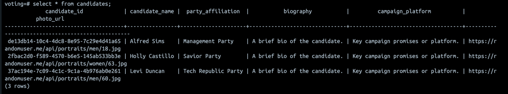

Realtime Election Voting System
===============================

This repository contains the code for a realtime election voting system. The system is built using Python, Kafka, Spark Streaming, Postgres and Streamlit. The system is built using Docker Compose to easily spin up the required services in Docker containers.

## System Architecture


## System Flow


## System Components
- **main.py**: This is the main Python script that creates the required tables on postgres (`candidates`, `voters` and `votes`), it also creates the Kafka topic and creates a copy of the `votes` table in the Kafka topic. It also contains the logic to consume the votes from the Kafka topic and produce data to `voters_topic` on Kafka.
- **voting.py**: This is the Python script that contains the logic to consume the votes from the Kafka topic (`voters_topic`), generate voting data and produce data to `votes_topic` on Kafka.
- **spark-streaming.py**: This is the Python script that contains the logic to consume the votes from the Kafka topic (`votes_topic`), enrich the data from postgres and aggregate the votes and produce data to specific topics on Kafka.
- **streamlit-app.py**: This is the Python script that contains the logic to consume the aggregated voting data from the Kafka topic as well as postgres and display the voting data in realtime using Streamlit.

## Setting up the System
This Docker Compose file allows you to easily spin up Zookkeeper, Kafka and Postgres application in Docker containers. 

### Prerequisites
- Python 3.9 or above installed on your machine
- Docker Compose installed on your machine
- Docker installed on your machine


### Steps to Run
1. Clone this repository.
2. Navigate to the root containing the Docker Compose file.
3. Run the following command:

```bash
docker-compose up -d
```
This command will start Zookeeper, Kafka and Postgres containers in detached mode (`-d` flag). Kafka will be accessible at `localhost:9092` and Postgres at `localhost:5432`.

##### Additional Configuration
If you need to modify Zookeeper configurations or change the exposed port, you can update the `docker-compose.yml` file according to your requirements.

### Running the App
1. Install the required Python packages using the following command:

```bash
pip install -r requirements.txt
```

2. Creating the required tables on Postgres and generating voter information on Kafka topic:

```bash
python main.py
```

3. Consuming the voter information from Kafka topic, generating voting data and producing data to Kafka topic:

```bash
python voting.py
```

4. Consuming the voting data from Kafka topic, enriching the data from Postgres and producing data to specific topics on Kafka:

```bash
python spark-streaming.py
```

5. Running the Streamlit app:

```bash
streamlit run streamlit-app.py
```

## Screenshots
### Candidates and Parties information

### Voters


### Voting


### Dashboard


## Video
[](https://youtu.be/X-JnC9daQxE)

## Iceberg lakehouse sink (extension)

The `iceberg/` folder adds a lakehouse sink on top of the streaming pipeline. Votes are
persisted in **Apache Iceberg** tables instead of existing only in Kafka and PostgreSQL:

| Requirement | How it is solved |
|---|---|
| Upsert aggregates without duplicates | `MERGE INTO` on `votes_per_candidate` / `turnout_by_location` |
| Change schema without rewriting history | `ALTER TABLE ... ADD COLUMN` keeps existing files valid |
| Audit what the counts looked like earlier | `VERSION AS OF <snapshot_id>` |
| Avoid full scans on history | table partitioned by `days(voting_time)` |

Verified on a clean run: facts and aggregates reconciled exactly (373 facts = 373
aggregated votes), and a facts-versus-aggregates check is part of the demo script.

```bash
python main.py            # tables + voters_topic
python voting.py          # vote events
python spark-streaming.py # aggregates to Kafka
cd iceberg
python iceberg_sink.py    # facts + MERGE aggregates into Iceberg
python iceberg_demo.py    # snapshots, schema evolution, time travel, reconciliation
streamlit run streamlit-app.py
```

## Changes from the reference architecture

I rebuilt this project on Windows and added the Iceberg sink. Along the way I fixed:

1. **Syntax error** in `main.py` - `insert_voters(...)` was missing its colon.
2. **Absolute paths** in `spark-streaming.py` pointing at another machine's home directory;
   replaced with project-relative paths.
3. **Port clash** - a local PostgreSQL 14 service already owned `5432`, so the containerised
   PostgreSQL is published on `5433` and the connection strings were updated.
4. **Stale environment variables** - `SPARK_HOME` and `HADOOP_HOME` pointed at folders that
   no longer existed. A small guard at the top of each Spark script resolves them to the
   installed packages, so the pipeline runs without manual setup.
5. **Scala version mismatch** - the Kafka connector was requested as `_2.13` while the
   PySpark 3.5.0 pip build ships Scala `_2.12`; corrected to `_2.12`.
6. **Missing winutils.exe** - Hadoop's `chmod` calls on Windows need it; documented and
   guarded in code rather than left as a prerequisite nobody reads.

### One finding worth recording: idempotency

During development the first micro-batch appended facts and then failed at the MERGE. On
restart the stream replayed from the checkpoint, producing **1,119 fact rows against 746
aggregated votes** - an orphan batch. It is a clean illustration of why exactly-once needs
either a transactional sink or a deterministic dedup key on the fact table, and why a
checkpoint alone is not enough. The sink now rebuilds aggregates from the fact table with
`MERGE`, so a replayed batch cannot double-count.

## Reference

The base architecture follows the well-known realtime voting data engineering walkthrough
(Python, Kafka, Spark, Postgres, Streamlit). The Iceberg sink, the Windows environment
guard, the port change and the fixes listed above are my own work on top of it.

